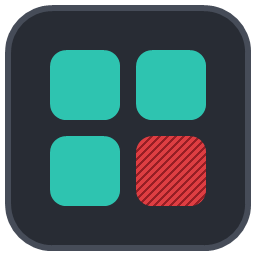
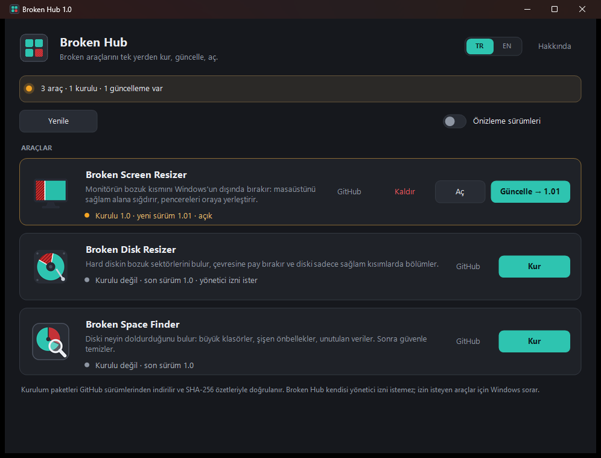
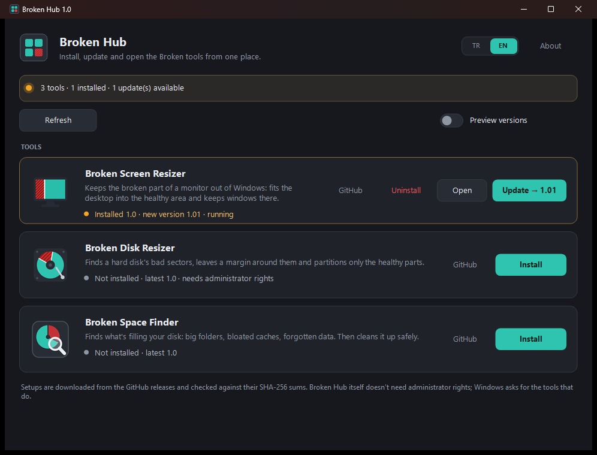

<h1 align="center">Broken Hub</h1>

<b>Broken araçlarını tek yerden kur, güncelle, aç.</b> 
Broken ailesinin bütün araçlarını bir pencerede gösterir: hangisi kurulu, hangisinin yeni sürümü var. Tek tıkla indirir, doğrular ve kurar.

<a href="#english">English</a> · <a href="https://github.com/HErkanuzun/BrokenHub/releases/latest">İndir / Download</a> · <a href="CHANGELOG.md">Sürüm geçmişi</a>

## Broken ailesi

Windows'ta bozuk ya da sorunlu bir şeyi bulup onunla yaşamanı sağlayan küçük araçlar. Hepsi aynı tasarım dilinde, ücretsiz ve açık kaynak.

| | |
|---|---|
| [Broken Screen Resizer](https://github.com/HErkanuzun/BrokenScreenResizer) | Monitörün bozuk kısmını Windows'un dışında bırakır. |
| [Broken Disk Resizer](https://github.com/HErkanuzun/BrokenDiskResizer) | Hard diskin bozuk sektörlerini bulur, sadece sağlam kısımları bölümler. |
| [Broken Space Finder](https://github.com/HErkanuzun/BrokenSpaceFinder) | Diski neyin doldurduğunu bulur ve güvenle temizler. |
| [Broken Microphone](https://github.com/HErkanuzun/BrokenMicrophone) | Telefonu ya da tableti bilgisayarın mikrofonu yapar. |
| **Broken Hub** | Hepsini tek yerden kurar, günceller ve açar. |

## Kurulum

1. [Son sürümden](https://github.com/HErkanuzun/BrokenHub/releases/latest) `BrokenHub-1.1-Setup.exe`'yi indir ve çalıştır. Yönetici izni istemez.
2. Başlat menüsünden **Broken Hub**'ı aç.

Kurulum istemiyorsan `Portable.zip`'i aç, içindeki exe'yi çalıştır.

> Exe imzalı olmadığı için Windows SmartScreen ilk açılışta "Windows bilgisayarınızı korudu" diyebilir: **Ek bilgi → Yine de çalıştır**.

## Nasıl çalışır

| | |
|---|---|
| **Kurulu sürüm** | Her aracın Windows "Uygulamalar" kaydından okunur (kurulum paketinin sabit kimliğiyle). |
| **Son sürüm** | GitHub sürümlerinden okunur. **Önizleme sürümleri** açıksa önizlemeler de hesaba katılır. |
| **Kur / Güncelle** | Kurulum paketi `%Temp%\BrokenHub`'a indirilir, SHA-256 özeti sürümle gelen `SHA256SUMS.txt` ile karşılaştırılır; uyuşmazsa dosya silinir ve hiçbir şey kurulmaz. Uyuşursa kurulum sessiz çalışır, bitince paket silinir. Araç açıksa kurulum onu düzgünce kapatır. |
| **Hepsini güncelle** | Birden fazla güncelleme varsa hepsini sırayla kurar. |
| **Kaldır** | Aracın kendi kaldırma aracını açar; verilerin silinip silinmeyeceğini o sorar. |
| **Yönetici izni** | Broken Hub istemez. Broken Disk Resizer ve Broken Space Finder'ın kurulumu ister; Windows sorar. |

Ayarlar `%AppData%\BrokenHub` klasöründe tutulur. **F5** yeniler.

## Kaynaktan derleme

Ek bir araç gerekmez; Windows'un kendi .NET Framework 4 derleyicisi kullanılır.

| Dosya | Ne yapar |
|---|---|
| `build.bat` | Sadece programı derler → `bin\BrokenHub.exe` |
| `paketle.bat` | Programı derler, Inno Setup yoksa `winget` ile kurar, `dist\` klasörüne **Setup.exe**, **Portable.zip** ve **SHA256SUMS.txt** üretir |
| `scripts\make-icon.ps1` | Logoyu ve simgeyi yeniden çizer |

Yeni bir araç eklemek için `src\Catalog.cs`'teki listeye bir satır ve `src\tool-<ad>.png` logosu yeterli.

---

## English

**Broken Hub** shows every Broken tool in one window: which ones are installed and which have a new version. One click downloads, verifies and installs.

**Install:** download `BrokenHub-1.1-Setup.exe` from the [latest release](https://github.com/HErkanuzun/BrokenHub/releases/latest) (or use the portable ZIP). It doesn't need administrator rights.

**How it works:** the installed version comes from each tool's Windows "Apps" entry; the latest version from its GitHub releases (turn on *Preview versions* to include previews). *Install/Update* downloads the setup to `%Temp%\BrokenHub`, checks its SHA-256 against the release's `SHA256SUMS.txt` (a mismatch deletes the file and installs nothing), runs it silently and deletes it afterwards. *Update all* installs every available update in turn. *Uninstall* runs the tool's own uninstaller. Windows asks for administrator rights only for the tools whose setup needs them.

**The Broken family:** [Broken Screen Resizer](https://github.com/HErkanuzun/BrokenScreenResizer) · [Broken Disk Resizer](https://github.com/HErkanuzun/BrokenDiskResizer) · [Broken Space Finder](https://github.com/HErkanuzun/BrokenSpaceFinder) · [Broken Microphone](https://github.com/HErkanuzun/BrokenMicrophone) · **Broken Hub**.

**[Code signing policy](SECURITY.md#code-signing-policy)** · Free code signing by SignPath Foundation · Kod imzalama politikası

MIT License.
